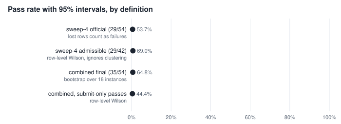
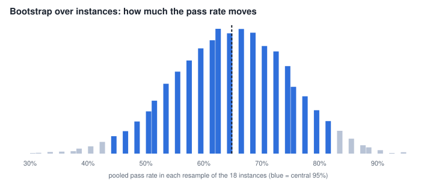
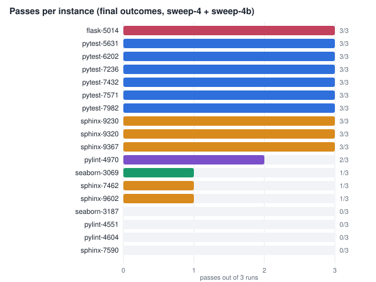
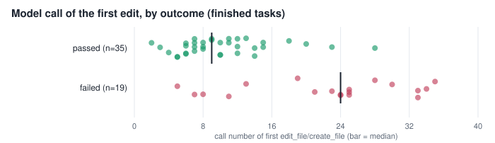
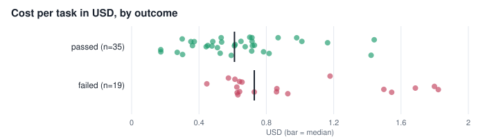

# Phase 1 benchmark: sweep-4 and sweep-4b

Single agent, Gemini 3.1 Pro on Vertex AI (`vertex-gemini-3-1-pro-preview`), 18 instances derived from SWE-bench Verified, 3 runs each (54 planned rows), `--no-pr`. Caps per task: $2, 150 calls, 40 steps per attempt, 3 scored attempts, one hour of agent clock. Every figure below is regenerated from `data/*.csv` by `analysis/analyze.py` (seeded; numbers are in `analysis/results.json`).

## 1. Headline

| Definition | Passed | Rate | 95% interval |
|---|---|---|---|
| **sweep-4, official** (passed / planned; the 12 rows lost to provider errors count as non-passes) | 29 / 54 | **53.7%** | 35.2 to 72.2 (bootstrap over instances) |
| sweep-4, secondary (passed / rows that finished; not the headline) | 29 / 42 | 69.0% | 54.0 to 80.9 (row-level Wilson) |
| sweep-4b alone (the re-run of the 12 lost rows) | 6 / 12 | 50.0% | 25.4 to 74.6 (Wilson) |
| **combined final outcomes** (each lost row replaced by its sweep-4b re-run) | 35 / 54 | **64.8%** | 44.4 to 83.3 (bootstrap over instances) |

**Which number to quote.** The report tool (`repolace-eval report`) produced the first row: 29/54. The last row is a substitution I did by hand: `repolace-eval report` never pools runs, so 35/54 is not a tool output. It is defensible, because a row lost to HTTP 429 says nothing about the agent, and the re-run used the same instances, model, limits and code. It is not the official headline. If a single sentence is needed: *"64.8% (35 of 54 task-runs; 95% interval over the 18 instances 44 to 83%), after re-running 12 rows lost to provider rate limits; 53.7% (29/54) if those rows are counted as failures."*

The interval is wide: one instance moves the rate by 5.6 points, and the bootstrap standard error is 9.9 points.





## 2. The 12 lost rows

All 12 sweep-4 rows ended as harness errors: Vertex AI returned `429 RESOURCE_EXHAUSTED` (the model was a Preview model on dynamic shared quota) and the gateway's bounded retries ran out. By repository: sphinx 6, pylint 3, seaborn 2, flask 1. They cost $3.64 for nothing.

Were they a random subset? The re-run passed 6 of 12 (50%) against 29 of 42 (69%) for the rows that finished. Fisher's exact test, two-sided: p = 0.31 (odds ratio 0.45). That is not evidence of a difference, and with 12 rows it could not be. It does mean the lost rows were concentrated in the harder repositories (sphinx, pylint), so dropping them (the 29/42 secondary) overstates the rate.

If the 12 rows had not been re-run, the headline would be bounded between 29/54 (53.7%, all would have failed) and 41/54 (75.9%, all would have passed).

## 3. Per instance

Passes out of 3 runs, over the final outcomes:

| Passes of 3 | Instances |
|---|---|
| 3 (10) | pytest-5631, 6202, 7236, 7432, 7571, 7982; flask-5014; sphinx-9230, 9320, 9367 |
| 2 (1) | pylint-4970 |
| 1 (3) | seaborn-3069, sphinx-7462, sphinx-9602 |
| 0 (4) | seaborn-3187, pylint-4551, pylint-4604, sphinx-7590 |



The distribution is bimodal: 14 of 18 instances are decided (always or never), 4 are mixed. The agent's result is mostly a property of the instance, not of the run.

- **Intraclass correlation** (one-way, runs within instance): ICC = 0.69. The design effect for 3 runs per instance is 1 + 2 x 0.69 = 2.38, so 54 rows are worth about **23 independent rows**. This is why the interval is taken over instances, and why a row-level Wilson interval (51.5 to 76.2) is too narrow.
- **pass@k** (unbiased estimator from 3 samples): pass@1 = 64.8%, pass@2 = 72.2%, pass@3 = 77.8%. A second and third attempt add 7 and 13 points, all of it from the four mixed instances.
- **Run index.** Passes by run index 0, 1, 2: 12, 11, 12. Cochran's Q = 0.50 (df 2), p = 0.78. No run-order effect.

## 4. By repository

| Repository | Instances | Rows | Passed | Rate | 95% Wilson (rows) |
|---|---|---|---|---|---|
| pytest | 6 | 18 | 18 | 100% | 82.4 to 100 |
| flask | 1 | 3 | 3 | 100% | 43.9 to 100 |
| sphinx | 6 | 18 | 11 | 61.1% | 38.6 to 79.7 |
| pylint | 3 | 9 | 2 | 22.2% | 6.3 to 54.7 |
| seaborn | 2 | 6 | 1 | 16.7% | 3.0 to 56.4 |

pytest is a third of the benchmark and all of it passes. Removing the six pytest instances leaves 17/36 = 47.2% (Wilson 32.0 to 63.0). Repository mix therefore moves the headline by 17 points; any comparison with another benchmark must match the mix. Per-repository intervals ignore clustering and are only indicative.

## 5. How the runs ended

| Stop reason | Passed | Failed | Pass rate |
|---|---|---|---|
| `submitted` (the agent called `submit`) | 24 | 2 | 92.3% |
| `step_cap` (40 steps used) | 11 | 17 | 39.3% |

Fisher's exact test p = 4.7e-05, odds ratio 18.5. Half the tasks (28 of 54, 51.9%) hit the step cap. Two cautions: stop reason is an outcome, not an assignment (a task that finds the fix early submits early, so this is association, not effect), and a step-cap task can still pass because the pipeline scores whatever tree remains. The conservative view, counting only passes where the agent submitted, is 24/54 = 44.4%.

## 6. Where the steps go

For all 54 final rows, the model call number of the first `edit_file`/`create_file`:

| Outcome | n | Median | Mean | 10th to 90th percentile |
|---|---|---|---|---|
| passed | 35 | 9 | 10.3 | 5 to 16.8 |
| failed | 19 | 24 | 22.3 | 7.8 to 33.2 |

Permutation test on the mean difference (-12.0 calls): p < 0.0001; on the median (-15): p = 0.0001. Probability that a random passing task edits before a random failing one: 0.84. Among the 17 step-cap failures the median first edit is call 25; among the 24 submitted passes it is call 10. In the step-cap failures 63.5% of tool calls were `run_tests`/`run_python`, 28.4% reads and searches, 8.1% edits.

This is descriptive. Hard instances need more investigation before they can be edited, so some of the gap is difficulty, not behaviour. It is the reason an early-edit variant (`exp/early-edit`, sweep-e1) was built; whether it helps is a separate, still-open experiment and is not part of this report.



## 7. Cost, tokens and time

Over the 54 final rows (the 12 lost rows' $3.64 is reported separately):

| | Mean | Median | 10th to 90th percentile |
|---|---|---|---|
| Cost per task | $0.751 | $0.645 | $0.355 to $1.435 |
| Cost, passed (35) | $0.634 | $0.611 | $0.301 to $0.999 |
| Cost, failed (19) | $0.966 | $0.729 | $0.606 to $1.708 |
| Model calls per task | 34.9 | 40 | 23 to 40 |
| Latency per task (s) | 1,197 | 1,106 | 683 to 1,781 |

Totals: $40.54 for the final rows, $44.17 including the lost rows. **Cost per pass: $1.16** ($1.26 counting the wasted spend). Failed tasks cost $0.33 more on average (permutation p = 0.0024) and take about 395 s longer (p = 0.0025). Largest single task: $1.82, below the $2 cap, so cost is not censored. Input tokens: 749k per task on average, 65.2% served from cache; output 11k per task. Latency runs from claim to the terminal write with one to three tasks sharing the machine, image build and index waits included, so it is not an agent-only figure.



## 8. Sensitivity of the headline to the counting rule

| Counting rule | k / n | Rate | 95% Wilson |
|---|---|---|---|
| sweep-4 official | 29 / 54 | 53.7% | 40.6 to 66.3 |
| sweep-4 secondary (finished rows only) | 29 / 42 | 69.0% | 54.0 to 80.9 |
| combined final outcomes | 35 / 54 | 64.8% | 51.5 to 76.2 |
| combined, only passes where the agent submitted | 24 / 54 | 44.4% | 32.0 to 57.6 |
| combined, pytest instances removed | 17 / 36 | 47.2% | 32.0 to 63.0 |

Reasonable counting rules span 44% to 69%. That spread, not any single digit, is the honest summary.

## 9. What this can and cannot support

- **Power.** With 18 instances, two configurations must differ by roughly 40 points before the difference is clear from instance noise alone (2.8 x sqrt(2) x 9.9). A paired exact McNemar test on instance-level outcomes needs 8:0 discordant instances for p = 0.008, 7:1 gives p = 0.07, 6:2 gives p = 0.29. Any variant claimed to be better on this set needs a very large effect, or more instances.
- **Contamination.** The instances come from public SWE-bench Verified, which models have probably seen. This is not the published Verified score and does not predict performance on unseen issues.
- **Selection.** The set is pure-Python, gold-validated, filtered for simple fixes, and 6 of 18 are pytest.
- **One model, one prompt, one code revision**, with `--no-pr` (no PR-opening path was exercised).
- **Provider variance.** Gemini 3.1 Pro Preview ran on dynamic shared quota, so outcomes are also a function of when the run happened. 429s are the only reason rows were lost, but tail latency and retries (and so wall time) depend on the day.
- **The saved sweep-4 report is a mid-run snapshot** (`data/sweep-4-report.md` shows 11 harness errors; the finished database has 12). The CSVs are from the finished database and are what the analysis uses.
- **Unrelated runs.** Gemini 3.8 Flash single agent (sweep-5, stopped at 8 passes of 31 finished tasks) and the role-split runs (sweep-r1, r2) are not headline results and are not included here.

## 10. Reproducing

```bash
python3 -I BENCHMARK/analysis/analyze.py   # no dependencies beyond the standard library
```

This rewrites `analysis/results.json` and the SVGs in `figures/` byte for byte (seed 20261025, 20,000 bootstrap resamples, 20,000 permutations). The CSVs themselves were exported from the development database (`tasks`, `llm_calls`, and `task_test_runs`-derived outcomes); see `BENCHMARK/README.md`.
