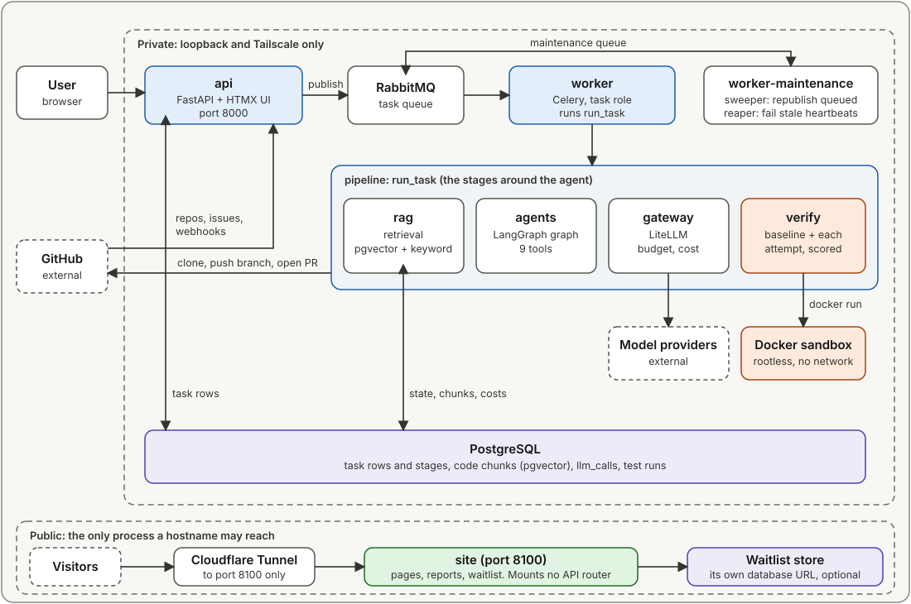

# repolace

repolace is an autonomous agent that takes a GitHub issue, finds the relevant code, writes a patch, runs the repository's own test suite in a locked-down sandbox, and opens a pull request if the checks hold. You register a repository through a GitHub App, pick one open issue and a target branch, and a worker does the rest.

Agents that patch issues are common. What this project is for is the part most of them skip: a measured success rate with cost and latency on real issues, model-written code that runs only inside a rootless container with no network, and hard bounds on every loop (3 scored attempts, 40 steps per attempt, $2 per task by default, one hour of agent time). The numbers below come from a recorded benchmark run, with its caveats stated next to them.

## Status

| Area | State |
|---|---|
| Task pipeline (clone, index, retrieve, baseline, agent, score, gate, push, PR) | Built. Runs from a Celery worker or from the `repolace-run-task` CLI |
| Agent (LangGraph, nine tools, feedback filter, conflict resolver) | Built and benchmarked. The role-split variant (planner, editor, reviewer) is unmerged and showed no benefit in its partial runs |
| Benchmark harness (`repolace-eval`) | Built and used for one headline sweep and a retrieval grid |
| Verify sandbox (rootless Docker) | Built. The 32 Docker containment tests have passed on a rootless daemon |
| Celery worker | Ran one task end to end, which opened one pull request on a private smoke-test repository. No other real PR has been opened |
| Pull-request opening at scale | **Not measured.** Every benchmark sweep used `--no-pr` |
| Task UI and JSON API | Built (server-rendered pages under `/ui`). **No authentication**: localhost or a private tunnel only |
| Public site (landing, pricing preview, benchmark reports, waitlist) | Built as a separate process that mounts none of the API routes |
| Public site on AWS | Deployed: the CDK stack, a push-to-deploy workflow with a reviewer approval, and a commit-sha check on `/healthz`. **Not yet tested:** reboot recovery, a backup restore |
| Observability | Structured JSON logs with a task id on every line. OpenTelemetry and Grafana are not started |
| Languages | Python repositories with pytest only. Indexing and the sandbox assume it |
| Accounts and billing | Account sign-in and Stripe billing are in development on a branch, not merged |

## Architecture



The API only inserts a `queued` row and publishes the task id to RabbitMQ. A Celery worker claims the row and runs the pipeline, so the retrieval stack and torch stay out of the API image. Model calls go through one gateway that prices, budgets and records every call. Test code runs only in the sandbox. Details: [docs/architecture.md](docs/architecture.md).

## How a task runs

1. **Register.** You install the GitHub App on a repository. GitHub's `installation` webhook registers it; there is no manual register route.
2. **Enqueue.** You pick an open issue and a target branch in `/ui/repos`, or `POST /repos/{id}/tasks`. A `queued` row is written and its id is published.
3. **Prepare.** The worker claims the row, makes a fresh full clone, re-indexes only the files that changed since the last index, retrieves code for the issue, and runs the test suite in the sandbox at the base commit. If that baseline run gives no usable result, the task ends there and the agent never runs.
4. **Edit.** The agent searches, reads, edits and probes with nine tools, then submits. Each attempt is scored in the sandbox against the baseline. A visible regression sends it back for another attempt, at most three.
5. **Gate.** The pipeline checks the score, the size of the change (at most 10 files and 500 lines by default) and whether the agent submitted. If the target branch moved while the task ran, a separate conflict-resolution agent merges it and the result is re-scored.
6. **Open the PR.** The change is squashed to one commit, pushed to a branch, and a pull request is opened that says `Refs #N`. The row records the outcome, the stop reason, the cost and every stage's timing.

## Results

First measurement, single agent, Gemini 3.1 Pro on Vertex AI, 18 instances from SWE-bench Verified, 3 runs each (54 planned rows), `--no-pr`:

| Definition | Passed | Rate | 95% interval over instances |
|---|---|---|---|
| sweep-4, official: 12 rows lost to provider rate limits counted as non-passes | 29 / 54 | **53.7%** | 35 to 72% |

Read it with these caveats:

- The interval is 35 to 40 points wide. One instance moves the rate by 5.6 points.
- The instances are public SWE-bench Verified issues that the model has probably seen. This is not the published Verified score and does not predict performance on unseen issues. Six of the 18 are pytest, and every pytest run passed.
- Twelve of the 54 rows were lost to HTTP 429 errors. Re-running them in sweep-4b passed 6; substituting each lost row by its re-run is a hand-stated calculation (35 of 54, 64.8%), not an output of the report tool, and it is not the headline.
- Across the 54 final rows (re-runs included), the mean task cost $0.75, about $1.16 per pass ($40.54 over the 35 passes of the final rows, not the 29 of the headline), with a median of 1,106 s per task. 52% of tasks ended on the step cap.
- Pull-request opening was not part of the measurement.

Method, statistics and reproduction: [docs/benchmark.md](docs/benchmark.md) and [BENCHMARK/REPORT.md](BENCHMARK/REPORT.md).

## Quick start

You need Python 3.12+, [uv](https://docs.astral.sh/uv/), Docker, git 2.38+, and a GitHub App. Running tasks also needs rootless Docker; the full list is in [docs/getting-started.md](docs/getting-started.md).

```bash
uv sync --all-packages
cp .env.example .env        # then fill in the GitHub App values
export DOCKER_HOST=unix:///run/user/$(id -u)/docker.sock && docker compose -f infra/docker-compose.yml up -d postgres redis rabbitmq
(cd api && uv run alembic upgrade head)
uv run --project api uvicorn repolace_api.main:app --port 8000
```

Then open `http://localhost:8000/ui/repos`. The guide covers creating the GitHub App, starting a worker and running your first task.

## Repository map

The repository is a uv workspace of nine packages.

| Path | What it holds |
|---|---|
| `api/` | FastAPI app: JSON routes, the server-rendered `/ui`, the GitHub webhook, Alembic migrations, and the separate public `site` app |
| `worker/` | Celery app: the `repolace.run_task` task, plus the sweeper and reaper jobs |
| `agents/` | LangGraph graph, prompts, feedback filter, the nine tools, the conflict resolver |
| `gateway/` | LiteLLM wrapper: stage routing from `models.toml`, pricing, per-task budget, `llm_calls` recorder |
| `rag/` | tree-sitter chunking, local embeddings, pgvector indexing, hybrid retrieval |
| `shared/` | DB models, git workspace, GitHub client, benchmark instance format, path guards |
| `pipeline/` | `run_task` and the stages around the agent; the `repolace-run-task` CLI |
| `verify/` | Docker sandbox backend, scoring, report plugin, hidden-test overlay |
| `eval/` | The `repolace-eval` benchmark harness and instance files |
| `infra/` | Docker Compose, env templates, the AWS CDK app for the public site |
| `BENCHMARK/` | The recorded run: data, analysis script, report |

## Documentation

Start at [docs/README.md](docs/README.md). The main pages:

- [Getting started](docs/getting-started.md): install, configure, run a task, run the tests
- [Architecture](docs/architecture.md): packages, task flow, retrieval, agent, gateway, sandbox
- [Benchmark](docs/benchmark.md): what is measured, how to reproduce it, the numbers
- [Security](docs/security.md): the sandbox, the oracle rule, what is not protected
- [Operations](docs/operations.md): compose services, worker notes, public site deployment
- [Reference](docs/reference/commands.md): routes, environment variables, tables, migrations, commands

## Security highlights

- Test code runs in a rootless Docker container with `--network=none`, a read-only root, all capabilities dropped, `no-new-privileges`, and memory, CPU and process caps.
- The sandbox receives a byte-exact export of the tracked tree with no `.git`, so it cannot plant hooks or rewrite remotes that the host later acts on. Only pass/fail data comes back out.
- Hidden benchmark tests never reach the agent; a feedback filter is the only place a scored result becomes text a model reads.
- Provider keys are handed to the gateway per call and never exported into the process environment, so git and Docker children cannot inherit them.
- The private API and task UI have no authentication. The public site is a separate process that mounts none of those routes. Do not expose the API or `/ui` to the internet.

## Contributing and license

Issues and small pull requests are welcome; read [CONTRIBUTING.md](CONTRIBUTING.md) first. Report vulnerabilities as described in [SECURITY.md](SECURITY.md). repolace is released under the MIT license; see [LICENSE](LICENSE).
