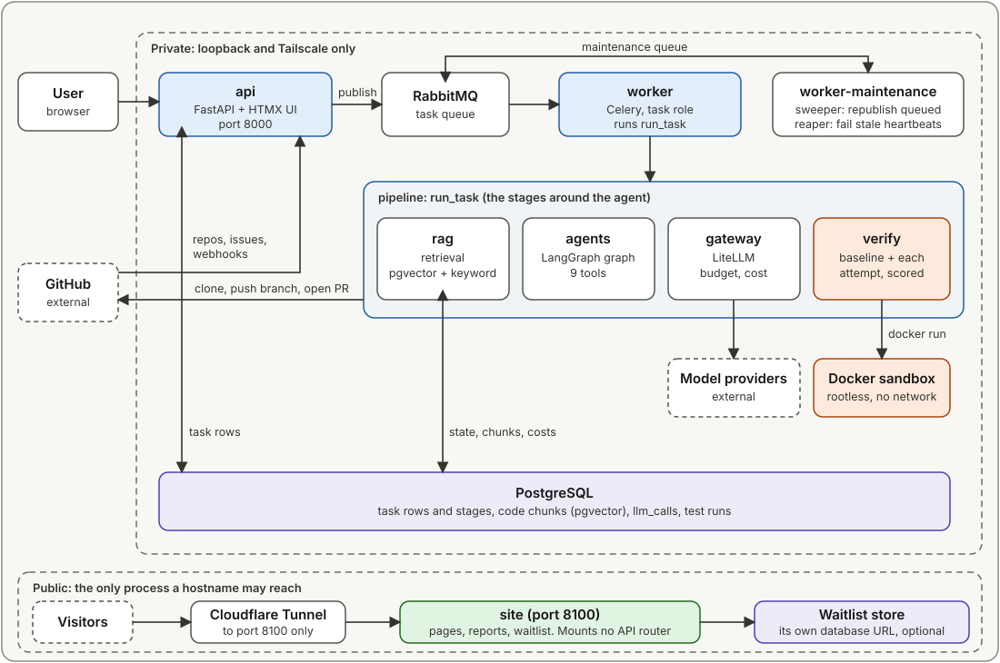
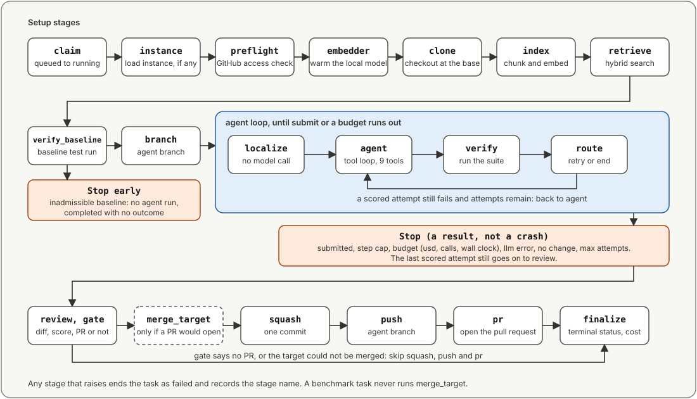
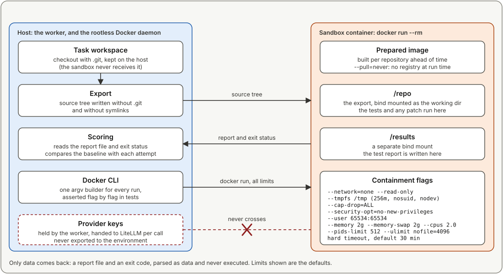

# Architecture

This page describes how repolace is built and how one task moves through it. Each claim points at the file that implements it. The reasoning behind each decision is in [CLAUDE.md](../CLAUDE.md) and [.claude/rules/](../.claude/rules/).

## Packages and dependency direction

The repository is a uv workspace of nine packages. Each has its own top-level import name (`repolace_api`, `repolace_worker`, `repolace_agents`, `repolace_gateway`, `repolace_shared`, `repolace_pipeline`, `retrieval`, `verify`, `harness`). Never give two packages the same name: editable installs append each package root to `sys.path`, and duplicates shadow each other.

| Package | Import name | Depends on (workspace) |
|---|---|---|
| `shared` | `repolace_shared` | nothing |
| `verify` | `verify` | shared |
| `gateway` | `repolace_gateway` | shared |
| `rag` | `retrieval` | shared |
| `agents` | `repolace_agents` | shared, gateway, verify |
| `pipeline` | `repolace_pipeline` | agents, gateway, rag, verify, shared |
| `worker` | `repolace_worker` | shared, pipeline, rag |
| `api` | `repolace_api` | shared |
| `eval` | `harness` | shared, verify, agents, gateway, rag |

The arrows that matter:

- `shared <- verify`, `shared <- gateway`, `shared <- rag`.
- `agents -> shared, gateway, verify`. **`agents` must not import `rag`.** That keeps torch out of agent tests; `agents/pyproject.toml` does not list it.
- `pipeline -> agents, gateway, rag, verify, shared`. The pipeline is the only place that joins the agent to retrieval.
- `api -> shared` only. The API image never imports the pipeline, torch or LiteLLM.
- `shared` depends on `pgvector` because `CodeChunk` must live in `shared/repolace_shared/db/models.py` with every other table. Tree-sitter and sentence-transformers stay in `rag/`.

## A task, end to end

### 1. Enqueue

`api/repolace_api/routes/repos.py::enqueue_task` is the single function behind both `POST /repos/{id}/tasks` and the UI form. It checks the target branch against GitHub, resolves the issue from GitHub (title and URL are never taken from the client), refuses a second `queued` or `running` task for the same issue and branch with a 409, inserts a `queued` row and commits.

`api/repolace_api/publisher.py::CeleryTaskPublisher.publish` then sends the task `repolace.run_task` by name, with the row id as both argument and Celery id. A publish failure is logged and never fails the request, because a `queued` row is exactly what the sweeper republishes.

### 2. Claim

`worker/repolace_worker/tasks.py::run_task_job` is the Celery task (`acks_late`, `reject_on_worker_lost`). It calls `run_one`, which:

- refuses a row that has `eval_run_id` set (benchmark rows belong to the eval runner);
- calls `run_task` inside `repolace_worker.bound.bounded(...)` with the per-task bound (11,700 s by default);
- logs and drops `TaskNotClaimable` and `TaskNotFound`, and logs any other exception without retrying.

A task row is never re-run. The `queued` to `running` claim is conditional, so a redelivered message finds a non-queued row and is dropped.

### 3. The pipeline stages

`pipeline/repolace_pipeline/run.py::run_task` runs these stages in order. Each writes a `task_stages` row (best effort) with its start, end and status.

| Stage | What happens |
|---|---|
| `instance` | Benchmark tasks: load the instance file. A product task has none, so the stage does nothing |
| `preflight` | Check the GitHub App installation grants `contents:write` and `pull_requests:write` |
| `embedder` | Warm the embedding model |
| `clone` | Full (not shallow) clone into a per-task temporary directory |
| `index` | Re-index only files changed since `registered_repos.indexed_commit_sha` |
| `retrieve` | Hybrid search for chunks relevant to the issue |
| `verify_baseline` | Run the repo's suite in the sandbox at the base commit |
| `record_baseline` | Store the baseline result |
| `baseline_files` | List every tracked path at the base commit, so scoring can tell a test file the agent added from a shipped module |
| `branch` | Create the working branch |
| `agent` | Run the agent; each attempt is scored in the sandbox |
| `review` | Compute the changed files and diff, judge the score, apply the PR gate |
| `merge_target` | **Product mode only**, and only when the gate would open a PR: merge the target branch if it moved, with the conflict resolver if needed, then re-score |
| `squash` | Squash to one commit |
| `push` | Push the branch |
| `pr` | Open the pull request |
| `finalize` | One conditional terminal write of status, outcome, cost and diff |

If the baseline is unusable (the suite collected nothing, the environment would not build, the run crashed), the task completes after the baseline with no agent run and a `score_reason` that starts `baseline unscoreable`.

## Retrieval

Code lives in `rag/retrieval/`.

- **Chunking** (`chunker.py`): tree-sitter parses each `.py` file into function, method, class-skeleton and module chunks. Other languages index to zero chunks, and the empty case is logged as `rag.index.no_python_files`.
- **Embeddings** (`embed.py`, `config.py`): a local sentence-transformers model, `flax-sentence-embeddings/st-codesearch-distilroberta-base`, 768 dimensions. It is local on purpose: indexing embeds every chunk, and a per-call price would make re-indexing and repeated benchmark runs expensive. The cost is that any image installing `rag/` pulls torch.
- **The 128-token limit**: the model's `max_seq_length` is 128 tokens, so a longer chunk is embedded from its opening tokens only. When this was measured over repolace's own 238 chunks, 99 (41.6%) exceeded it. That figure describes this repository's code at one point in time; measure again before quoting it for another corpus. Four embedding strategies (`truncate`, `head_tail`, `windows`, `signature_docstring`) are implemented in `strategies.py`, and the benchmark compared them (see [benchmark.md](benchmark.md)). The default stays `truncate`.
- **Storage**: chunks and vectors are rows of `code_chunks` in Postgres with pgvector (HNSW index) and a full-text index.
- **Search** (`retrieve.py::hybrid_search`): a semantic arm and a keyword arm are merged by reciprocal-rank fusion (`ranking.py`, `RRF_K = 60`). The keyword arm takes identifiers, the semantic arm a short description, both built by `build_query` from the issue.
- **Freshness** (`index.py::reindex_if_stale`): a transaction-scoped advisory lock makes indexing single-flight per repository. A mismatch between the stored strategy and the configured one forces a full re-index.

## The agent

Code lives in `agents/repolace_agents/`.

The graph (`graph.py`) is `localize -> agent -> verify`, then a conditional edge `route` back to `agent` or to the end. `localize` makes no model call. `agent` is a bounded tool loop and the only node that calls the model. `verify` is the only node that reads a scored result, and only to pass it to the feedback filter. Scoring, the gate, the push and the final write are in the pipeline, because they need git, Postgres and GitHub.

**Nine tools** (`agents/repolace_agents/tools/`): `search_code`, `read_file`, `grep`, `list_dir`, `edit_file`, `create_file`, `run_python`, `run_tests`, `submit`. A tool schema is enforced by the toolbox, and every path goes through one confinement function that refuses symlinks, `.git*` components and, for writes, any dotfile or protected file.

**Bounds**:

| Bound | Value |
|---|---|
| Scored attempts | 3 |
| Model calls (steps) per attempt | 40 |
| Tool calls executed per model reply | 8 |
| Cost per task | $2.00, or `REPOLACE_TASK_MAX_USD` |
| Model calls per task | 150 |
| Agent wall clock | 3,600 s, started when the `agent` stage starts |

**Stop reasons** (`tasks.agent_stop_reason`): `submitted`, `step_cap`, `budget_usd`, `budget_calls`, `budget_wall`, `llm_error`, `no_change`, `max_attempts`.

**Conflict resolver** (`resolver.py`): a separate agent with its own graph and five tools. It never runs git. The host re-checks for conflict markers and commits.

## The gateway

Code lives in `gateway/repolace_gateway/`.

- **Stage routing**: `gateway/models.toml` maps a stage (`agent`, `cheap`, and an optional `resolve` that follows `agent`) to a model. `GATEWAY_STAGE_MODELS` overrides it for one run.
- **Pricing**: every model needs a price in `models.toml` (USD per million tokens). An unpriced model is rejected before its first call, and `cost_usd` is `NULL`, not zero, when no priced call was made.
- **Budget**: `budget.py` keeps the active task and its `TaskBudget` in a context variable set by `task_scope(task_id, budget)`. A model call outside a scope raises `NoTaskScope`. The cap is checked in the gateway, not trusted to the agent.
- **Recording**: `recorder.py` writes every call to `llm_calls` (request, response, tokens, cost) on its own session, after redacting credential-shaped strings. The table stores repository source verbatim, which matters for private repositories.
- **Providers**: LiteLLM, plus a small REST transport for Gemini on Vertex AI (`vertex.py`). The headline benchmark model is `vertex-gemini-3-1-pro-preview`. Retries use exponential backoff with jitter (up to 21 tries per model, set in `models.toml`).

## The sandbox

Code lives in `verify/verify/`. `backends/docker.py::DockerBackend` drives the `docker` CLI. `build_run_argv` is a pure function that returns the full argument list, so a test can assert each containment flag on its own. The flags and the reasoning are in [security.md](security.md).

In short: the repo's code runs inside, from a prepared per-repo image, against an export of the tracked tree without `.git`. Cloning, indexing, every model call, applying patches and opening the PR stay on the host. No agent runs inside the sandbox; Verify is a stage.

## Data model

The schema has eight tables: `github_installations`, `registered_repos`, `tasks`, `task_stages`, `task_test_runs`, `llm_calls`, `code_chunks` and `waitlist_signups`. Migrations run from 0001 to 0017 on `main`. See [reference/tables.md](reference/tables.md) and [reference/migrations.md](reference/migrations.md).

Three design points:

- `tasks.status` is one of six values; `failed` means repolace itself broke and is the only status that sets `error_message`. An agent-caused stop is `completed` with an outcome and a stop reason.
- `task_test_runs` stores raw sets of passing and failing tests per attempt, so a score can be recomputed.
- The terminal write is conditional on `running`, so a late or duplicate writer cannot resurrect a finished task.

## Failure and recovery

| Situation | What happens |
|---|---|
| Broker down at enqueue | The row stays `queued`. The sweeper in `worker-maintenance` republishes `queued` product rows older than 5 minutes, at most once per 15 minutes per row, 50 per tick |
| Worker dies mid-task | The pipeline heartbeats every 30 s. The reaper fails a `running` product row (no `eval_run_id`) whose heartbeat is older than 5 minutes with `runner: abandoned` and removes the task's containers |
| Task exceeds its bound | The row reads `interrupted: WorkerTimeout`; Celery's hard limit is the bound plus 600 s |
| Duplicate delivery | The conditional claim drops it |
| Container outlives a timeout | The backend removes it by name, since killing the client does not stop it |

A row is never re-run. To try an issue again, enqueue a new task.
